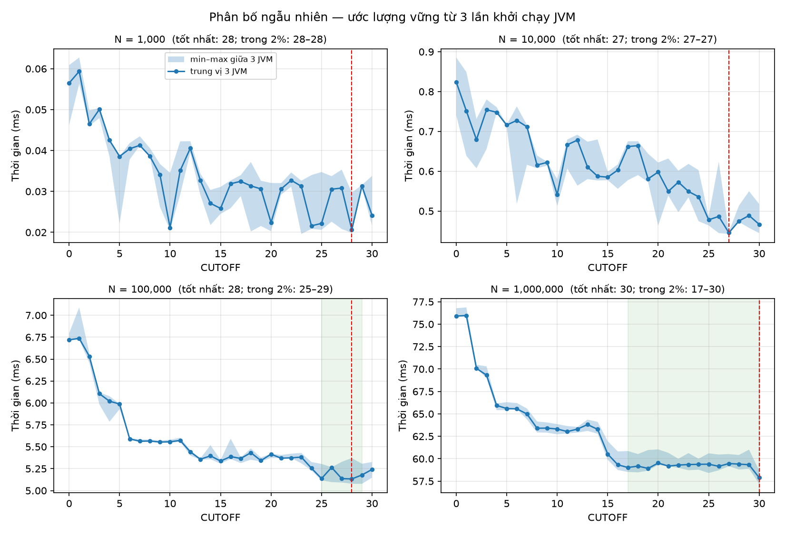

# Hybrid Mergesort: xác định ngưỡng CUTOFF tối ưu

Thí nghiệm đo thời gian Mergesort kết hợp Insertion Sort (Java 21) với CUTOFF từ 0 đến 30
(khảo sát mở rộng tới 64), trên 4 dạng dữ liệu (ngẫu nhiên, tăng dần, giảm dần, trùng lặp)
và 4 quy mô N = 10³…10⁶. Báo cáo đầy đủ: [Report.pdf](Report.pdf).

## Kết quả chính (N = 10⁶, so với Mergesort thuần)

- Ngẫu nhiên: nhanh hơn khoảng 24% (tới 28% ở khảo sát 0–64), chưa thấy tối ưu bên trong dải.
- Tăng dần: nhanh hơn 49–55%, CUTOFF càng lớn càng tốt trong dải khảo sát.
- Giảm dần: nhanh hơn khoảng 38%, tối ưu quanh CUTOFF 8–14, thời gian tăng lại khi CUTOFF lớn.
- Trùng lặp: nhanh hơn 32–39%.
- Kết quả ở N ≤ 10⁴ nhiễu mạnh, nên kết luận dựa chủ yếu vào N = 10⁵ và 10⁶.



## Cấu trúc thư mục

```
src/          MergesortHybrid.java, DataGenerator.java, BenchmarkRunner.java,
              analyze.py, analyze_forks.py, analyze_groups.py
data/         dữ liệu sinh với SEED = 4214
results/      raw_fork1-3.csv, summary_statistics.csv, robust_*.csv, ext64/, các hình
logs/         environment.txt, nhật ký chạy
run_all.ps1   chạy lại toàn bộ thí nghiệm
Report.pdf    báo cáo đầy đủ
```

## Yêu cầu

- JDK 17 trở lên (đã dùng Temurin 21).
- Python 3.10+ với `pandas`, `scipy`, `matplotlib`:

```powershell
py -m pip install pandas scipy matplotlib
```

## Cách chạy

Chạy toàn bộ thí nghiệm (khoảng 30–35 phút, Windows PowerShell):

```powershell
powershell -ExecutionPolicy Bypass -File .\run_all.ps1
```

> **Cảnh báo:** `run_all.ps1` xoá và tạo lại `out/`, `data/`, `results/`, `logs/`.
> Hãy sao lưu kết quả hiện có trước khi chạy. Nên chạy lúc máy rảnh và cắm điện.

Chạy thử nhanh (3 lượt đo, chỉ để kiểm tra, không dùng làm kết quả):

```powershell
javac -encoding UTF-8 -d out src\MergesortHybrid.java src\DataGenerator.java src\BenchmarkRunner.java
java -cp out MergesortHybrid
java -cp out DataGenerator data
java -cp out BenchmarkRunner results\test.csv 3 2 30
```

`java -cp out MergesortHybrid` phải in `MergesortHybrid self-test: OK`.

## Môi trường đo

AMD Ryzen 7 H 255, 8 nhân / 16 luồng, RAM ≈ 24 GB, Windows 11 Home,
OpenJDK Temurin 21.0.13, JVM `-Xms512m -Xmx1g -XX:+UseSerialGC`.
Máy cắm điện, không có ứng dụng nào khác chạy song song khi đo.

## Hạn chế

Một máy duy nhất; 3 lần khởi chạy JVM; khảo sát 0–64 chỉ một lần chạy; chưa bật tối ưu
"bỏ qua merge". Số tuyệt đối gắn với phần cứng này. Chi tiết trong báo cáo.

## Tác giả

Hoàng Anh Tuấn – CS1058_8
